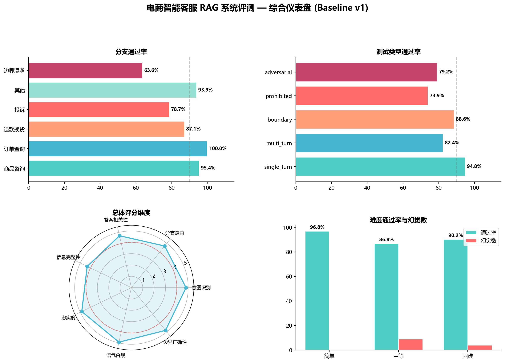

# 👋 Hi, 我是郭超群

**大模型评测 / AI 质量方向** · 信息与计算科学专业
专注把 AI 产品的效果从"感觉不错"变成**可量化、可回归、可验收**——评测用例设计 → 双通道判分 → Bad Case 归因 → 回归验证。

**关键词**：`LLM-as-a-Judge` `评测数据集构建` `Rubric 设计` `Bad Case 归因` `回归测试` `质量门禁` `幻觉检测`

---

## 📄 作品集

> 📄 完整作品集（含界面截图与数据图表）：**[作品集 · 飞书文档](https://xcnaaqfol96z.feishu.cn/docx/UDmldSWS2oKykaxUrUOcojobnwl)**

**📌 求职方向**：大模型评测 / AI 测试 / 模型质量运营
**📍 城市**：杭州 / 上海 / 长三角 · 亦接受远程
**⏱ 到岗**：可立即到岗 · 全职

---

## 📚 AI 评测知识体系（我整理的）

> 把两个项目里用过的评测方法整理成一套可复用的知识体系——**每个知识点都标注了我自己的实战案例**，不是抄来的笔记：

三层评测模型 · 评测维度设计 · 评测集构建（5 类型 × 难度分级）· 规则 + LLM Judge 双通道判分 · **Judge 可靠性验证**（位置偏置 / 量表遵从性 / 裕度分布三项探针）· 黄金集与三层门禁 · 复评基准消除评测污染 · 失败归因 · 统计验证 · 变异测试

→ [完整版：AI 评测知识体系](AI-EVAL-KNOWLEDGE.md)

---

## 🚀 项目作品集

### 项目一 · 电商智能客服 · AI 评测体系（505 用例 + 双通道判分）

> 完整实践了 AI 效果验证的全流程：怎么定义"答得好"、怎么出题考模型、怎么找到错因、怎么证明改进是真的。

- 📊 **量化结果**：通过率 91.5% → 97.0%，幻觉率 8.3% → 2.6%，违规率 8.9% → 0
- 🧩 **评测集构建**：505 条用例 × 5 类测试（功能/边界/违禁/多轮/对抗）× 3 级难度，每条 17 字段、case_id 跨版本追踪
- ⚖️ **双通道判分**：确定性规则预检 + LLM-as-a-Judge（裁判 v4.0→v4.4 迭代，人工盲评校准）
- 🔁 **复评基准**：同一裁判口径重评历史版本，消除评测工具漂移——旧裁判系统性低估幻觉率（3.0% → 真实 8.3%）
- 🔍 **Bad Case 归因**：8 类根因，72.1% 集中于分类误路由，按「影响面 × 修复难度」排优先级

→ 查看评测项目仓库：[点击访问](https://github.com/guo-chaoqun/ecommerce-ai-customer-service)

---

### 项目二 · AI 穿搭导购系统 · 质量工程实践

> 多模态 AI 产品的质量保障：627 条自动化断言 + 三层质量门禁 + 变异测试。

- 🧪 **627 条自动化断言**：E2E + 单测 + 集成，覆盖搭配生成、试穿、衣橱全链路
- 🚪 **三层质量门禁**：黄金集 34 例回归，改动必过门禁
- ☠️ **变异测试 60+**：故意注入故障验证"测试本身有效"，避免用例形同虚设
- 🎯 **混合架构**：规则保下限（确定性）+ AI 冲上限（创造性）

→ 查看穿搭项目仓库：[点击访问](https://github.com/guo-chaoqun/ai-stylist-advisor)

---

## 🧠 我的评测方法论

- **有评测才有迭代**：任何 AI 产品，先搭评测体系再动功能
- **裁判本身也要被验证**：LLM 裁判需人工盲评校准 + 偏置探针（位置偏置 / 量表遵从性 / 裕度分布）
- **Bad Case 归因到根**：不看"错了几条"，看"为什么错、错得集不集中"
- **改动必回归**：黄金集 + 质量门禁，防止修好这里、弄坏那里

---

## 📬 联系我

- 邮箱：**168314684@qq.com**
- 求职：大模型评测 / AI 测试 / 模型质量（可立即到岗 · 全职）
- 简历：[简历 PDF · 下载](https://xcnaaqfol96z.feishu.cn/file/Vxogbu9pro26zmxdydWcxugynM0)
- 作品集：[作品集 · 飞书文档](https://xcnaaqfol96z.feishu.cn/docx/UDmldSWS2oKykaxUrUOcojobnwl)
